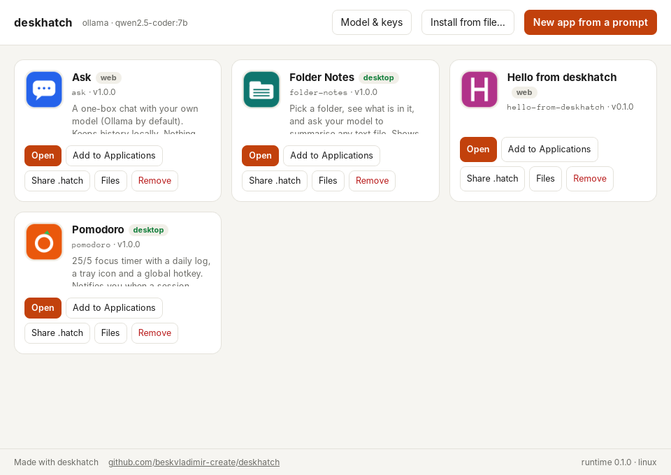
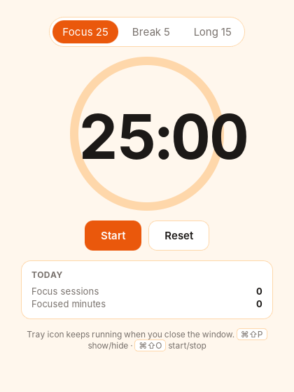

# deskhatch

**Turn any AI-generated HTML into a real desktop app.** Own icon, own window, notifications, tray, global hotkeys, scoped file access. Offline. No account. Your model (Ollama, LM Studio, llama.cpp, or any API key). macOS and Linux.

Claude recently added "Install as app" for its artifacts. It is great, and it is closed: online only, signed in only, no Linux, metered through your subscription. deskhatch is the open version of the same idea, and it works with HTML from anywhere: Claude, ChatGPT, Gemini, your editor, a 2009 jQuery page.

```bash
npx deskhatch install page.html          # → "Page" in your Applications, icon in the dock, 2 seconds
npx deskhatch new "a pomodoro timer with a tray icon and a daily log"   # your model writes it, deskhatch installs it
```

<p align="center">
  
</p>

## Why

| | Claude "Install as app" | **deskhatch** |
|---|---|---|
| Works offline | no | **yes** |
| Needs an account | yes | **no** |
| Model | Claude, counted against your plan | **any**: Ollama / llama.cpp / LM Studio locally, or your own key for OpenAI, OpenRouter, Groq, Mistral, DeepSeek… |
| Platforms | macOS, Windows | **macOS, Linux** (Windows: [#1](https://github.com/beskvladimir-create/deskhatch/issues/1)) |
| Share an app | link to Claude | **a file** (`.hatch`), double-click to install |
| Source of the HTML | Claude artifacts | **anything** |
| Permissions | three tiers | three tiers, enforced in Rust, visible in the gallery |
| License | — | MIT |

## How it works

No compiler, no per-app build. One small signed runtime (Tauri 2, Rust, ~10 MB) hosts app packages:

```
my-app/
  app.json     name, icon, window size, permissions, hotkeys, model defaults
  index.html   the app
  icon.png
```

`install` copies the package to `~/.deskhatch/apps/<id>` and drops a launcher in `~/Applications` (macOS) or the app menu (Linux). The launcher starts the runtime with `--app <id>`. The page gets a `hatch` object:

```js
const answer = await hatch.llm.chat("Summarise this: " + text);   // your model, your key, never in the HTML
await hatch.store.set("notes", notes);                             // per-app persistent store
await hatch.notify("Done", "Session finished");                    // desktop tier
const dir = await hatch.fs.pickFolder();                           // the user picks; the app sees only that folder
hatch.on("hotkey", name => …);                                     // global hotkeys from app.json
```

Full API and manifest: [SPEC.md](SPEC.md).

### Permissions

| tier | page network | model | notifications, tray, hotkeys | files |
|---|---|---|---|---|
| `web` (default) | none | via runtime | – | – |
| `desktop` | only `allowedHosts` | via runtime | ✓ | folders the user picked |
| `full` | only `allowedHosts` | via runtime | ✓ | home folder |

The tier is enforced by the runtime and by the page's content-security-policy; the HTML cannot escalate itself. A `web` app from a stranger cannot phone home, read files or load remote scripts. Keys live in the OS keychain, never in a package.

## Install

Requires Node 18+ for the `npx` wrapper (the runtime itself has no dependencies).

```bash
npx deskhatch gallery                      # downloads the runtime once, opens the gallery
npx deskhatch install examples/pomodoro    # a folder with app.json
npx deskhatch install hello.html           # a bare HTML file
npx deskhatch install friend.hatch         # a package someone sent you
```

Or grab the runtime from [Releases](https://github.com/beskvladimir-create/deskhatch/releases) and drop `.hatch` files on it.

### Pick a model

```bash
ollama pull qwen2.5-coder:7b               # default provider is Ollama at localhost:11434
npx deskhatch config --provider openai --model gpt-4o-mini
npx deskhatch key openai                   # paste the key; it goes to the keychain
npx deskhatch models                       # what the endpoint offers
```

Any OpenAI-compatible endpoint works: `--provider custom --endpoint http://host:port/v1`.

### Generate an app from a prompt

```bash
npx deskhatch new "a clipboard-style scratchpad with 5 tabs, autosave, and a button that rewrites the text in plain English" --tier web --run
```

The runtime sends the prompt plus the `hatch` API reference to your model, validates the result, installs it and creates the launcher. With a 7B local model expect a functional, plain app; with a frontier model via API expect something you would ship. Either way the HTML is yours: `~/.deskhatch/apps/<id>/index.html`, edit it and relaunch.

### Develop

```bash
npx deskhatch dev ./my-app                 # runs the folder, reloads on save
npx deskhatch export my-app                # → my-app.hatch to share
```

## Examples

| | | |
|---|---|---|
| [`examples/pomodoro`](examples/pomodoro) | `desktop` | timer, notifications, tray icon, global hotkeys, daily log |
| [`examples/ask`](examples/ask) | `web` | one-box chat with your model, local history |
| [`examples/folder-notes`](examples/folder-notes) | `desktop` | pick a folder, browse it, summarise files with your model |
| [`examples/hello.html`](examples/hello.html) | `web` | a bare HTML file, to show that nothing else is needed |

<p align="center">
  
  
</p>

## Status

v0.1, built in a day, launched the same week Claude shipped the feature. Runtime, CLI, tiers, model bridge and generation are covered by headless tests on Linux (Ubuntu 22.04) in CI; macOS builds are produced by the release workflow. What is still open:

- **Windows**: the runtime compiles, launchers and signing do not exist yet. Vote on [#1](https://github.com/beskvladimir-create/deskhatch/issues/1).
- macOS menu bar shows "Deskhatch" as the application name inside your app's menu (the dock icon and window title are yours). Tracked in [#2](https://github.com/beskvladimir-create/deskhatch/issues/2).
- Streaming replies from `hatch.llm.chat` ([#3](https://github.com/beskvladimir-create/deskhatch/issues/3)).
- Importing a Claude artifact straight from its share link ([#4](https://github.com/beskvladimir-create/deskhatch/issues/4)).

Issues and PRs welcome. If you built something with it, add it to [docs/showcase.md](docs/showcase.md).

## Build from source

```bash
# Rust stable, Node 18+. Linux: libwebkit2gtk-4.1-dev libayatana-appindicator3-dev librsvg2-dev
cd runtime && cargo build --release          # → target/release/deskhatch
DESKHATCH_BIN=$PWD/target/release/deskhatch node ../cli/index.js list
npx @tauri-apps/cli@2 build                  # bundles (.app / .AppImage / .deb)
```

## Security notes

- Packages are plain files; read `index.html` before installing something from a stranger, the same way you would read a script.
- `web` apps cannot reach the network from the page. The only way out is `hatch.llm.chat`, which talks to the endpoint *you* configured.
- `~/.deskhatch`, `~/.ssh`, `~/.gnupg` and `~/.aws` are never accessible to any tier.
- The release workflow signs and notarizes the macOS runtime when the Apple secrets are present; launchers are tiny local bundles that point at it, so there is nothing to re-sign per app. Check the release notes of a build for its signing status.

## License

MIT © [Vladimir Beskorovainyi](https://besk.tech)
