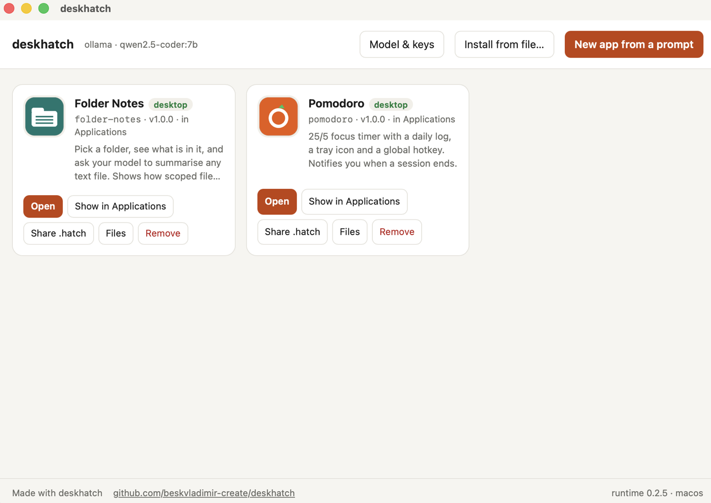
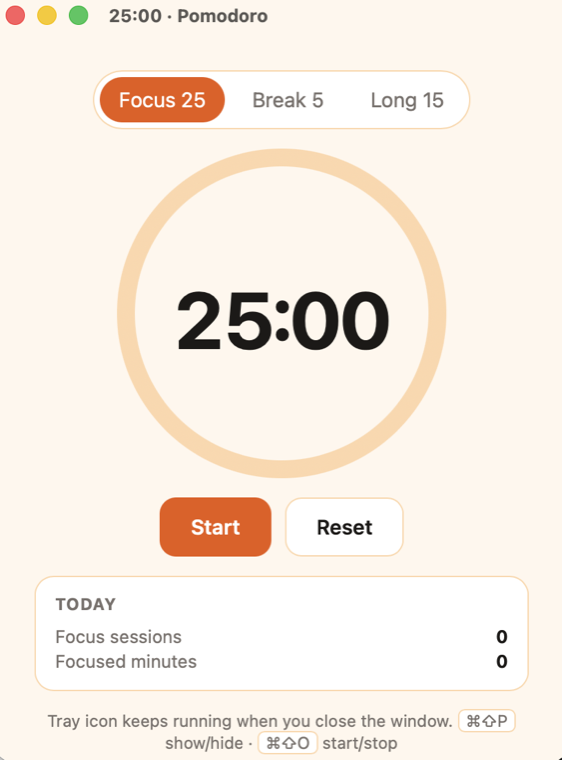
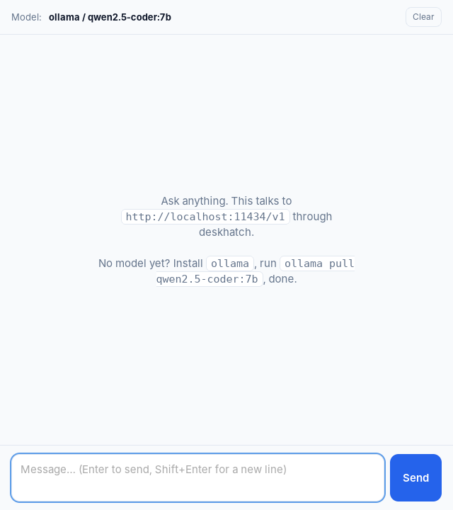

# deskhatch

**Turn any AI-generated HTML into a real desktop app.** Own icon, own window, notifications, tray, global hotkeys, scoped file access. Offline. No account. Your model (Ollama, LM Studio, llama.cpp, or any API key). macOS and Linux.

Claude recently added "Install as app" for its artifacts. It is great, and it is closed: online only, signed in only, no Linux, metered through your subscription. deskhatch is the open version of the same idea, and it works with HTML from anywhere: Claude, ChatGPT, Gemini, your editor, a 2009 jQuery page.

```bash
npx deskhatch install page.html          # → "Page" in your Applications, icon in the dock, 2 seconds
npx deskhatch new "a pomodoro timer with a tray icon and a daily log"   # your model writes it, deskhatch installs it
```

<p align="center">
  
</p>

## What you get

- **Your one-off AI pages become real tools.** The calculator, habit tracker or timer that ChatGPT or Claude wrote for you stops living in a browser tab. One command, and it has an icon in the dock, a window, notifications and a hotkey.
- **Private automation without code or cloud.** "Summarise every contract in this folder" as an app that talks to Ollama on your machine and sees only the folder you picked. Nothing leaves the computer.
- **Apps you can hand to someone.** Export a `.hatch` file, send it, the other person double-clicks it. No store, no account, no build.
- **Linux, and no sign-in.** The only version of this idea that runs there.

Not for you if a browser tab is enough, or if you would rather wire up Tauri or Electron yourself.

## Why

| | Claude "Install as app" | **deskhatch** |
|---|---|---|
| Works offline | no | **yes** |
| Needs an account | yes | **no** |
| Model | Claude, counted against your plan | **any**: Ollama / llama.cpp / LM Studio locally, or your own key for OpenAI, OpenRouter, Groq, Mistral, DeepSeek… |
| Platforms | macOS, Windows | **macOS, Linux** (Windows: [#1](https://github.com/beskvladimir-create/deskhatch/issues/1)) |
| Share an app | link to Claude | **a file** (`.hatch`), double-click to install |
| Source of the HTML | Claude artifacts | **anything** |
| Permissions | three tiers | three tiers, enforced in Rust, visible in the gallery |
| License | — | MIT |

## How it works

No compiler, no per-app build. One small signed runtime (Tauri 2, Rust, ~5 MB) hosts app packages:

```
my-app/
  app.json     name, icon, window size, permissions, hotkeys, model defaults
  index.html   the app
  icon.png
```

`install` copies the package to `~/.deskhatch/apps/<id>` and drops a launcher in `~/Applications` (macOS) or the app menu (Linux). The launcher starts the runtime with `--app <id>`. On macOS `--standalone` gives the app its own copy of the runtime instead, so its name shows up everywhere the system asks for one. The page gets a `hatch` object:

```js
const answer = await hatch.llm.chat("Summarise this: " + text);   // your model, your key, never in the HTML
await hatch.store.set("notes", notes);                             // per-app persistent store
await hatch.notify("Done", "Session finished");                    // desktop tier
const dir = await hatch.fs.pickFolder();                           // the user picks; the app sees only that folder
hatch.on("hotkey", name => …);                                     // global hotkeys from app.json
```

Full API and manifest: [SPEC.md](SPEC.md).

### Permissions

| tier | page network | model | notifications, tray, hotkeys | files |
|---|---|---|---|---|
| `web` (default) | none | via runtime | – | – |
| `desktop` | only `allowedHosts` | via runtime | ✓ | folders the user picked |
| `full` | only `allowedHosts` | via runtime | ✓ | home folder |

The tier is enforced by the runtime and by the page's content-security-policy; the HTML cannot escalate itself. See [Security notes](#security-notes) for exactly what each tier can and cannot reach. A `web` app from a stranger cannot phone home, read files or load remote scripts, images or fonts. Remote media for `desktop` and `full` come only from `allowedHosts`. Keys live in the OS keychain, never in a package, and go only to model endpoints you configured: an `endpoint` in `app.json` is used only if it is one you set. Installing a package that asks for `desktop` or `full`, names a model endpoint or replaces an installed app shows what it asks for and waits for your yes (`--yes` skips the question in scripts).

## Install

Requires Node 18+ for the `npx` wrapper (the runtime itself has no dependencies).

```bash
npx deskhatch gallery                      # downloads the runtime once, opens the gallery
npx deskhatch install examples/pomodoro    # a folder with app.json
npx deskhatch install hello.html           # a bare HTML file
npx deskhatch install friend.hatch         # a package someone sent you
npx deskhatch install examples/ask --standalone   # macOS: own bundle, own name everywhere
```

On macOS an app installed the usual way runs inside the shared runtime bundle, so the system
calls it "Deskhatch" in the menu bar, the app switcher and the notification settings, even though
its window, dock icon and title are its own. `--standalone` copies the runtime into
`~/Applications/<Name>.app` with the app's own name, identifier and icon: about 5 MB per app,
and the right name in every one of those places. The copy is re-signed ad-hoc locally and is
refreshed by `npx deskhatch update`, which rebuilds every launcher.

Or grab the runtime from [Releases](https://github.com/beskvladimir-create/deskhatch/releases) and drop `.hatch` files on it. Linux: the `npx` wrapper uses the AppImage. The AppImage runtime is static and carries FUSE inside, so no `libfuse2` package is needed; it mounts itself and starts fast wherever `/dev/fuse` and a setuid `fusermount` are present, which is an ordinary desktop. Where they are not, a container for instance, the wrapper runs the AppImage self-extracting, which works but is slower. A `.deb` is in Releases too.

### Pick a model

```bash
ollama pull qwen2.5-coder:7b               # default provider is Ollama at localhost:11434
npx deskhatch config --provider openai --model gpt-4o-mini
npx deskhatch key openai                   # paste the key; it goes to the keychain
npx deskhatch models                       # what the endpoint offers
```

Any OpenAI-compatible endpoint works: `--provider custom --endpoint http://host:port/v1`.

### Generate an app from a prompt

```bash
npx deskhatch new "a clipboard-style scratchpad with 5 tabs, autosave, and a button that rewrites the text in plain English" --tier web --run
```

The runtime sends the prompt plus the `hatch` API reference to your model, validates the result, installs it and creates the launcher. With a 7B local model expect a functional, plain app; with a frontier model via API expect something you would ship. Either way the HTML is yours: `~/.deskhatch/apps/<id>/index.html`, edit it and relaunch.

### Develop

```bash
npx deskhatch dev ./my-app                 # runs the folder, reloads on save
npx deskhatch export my-app                # → my-app.hatch to share
```

## Examples

| | | |
|---|---|---|
| [`examples/pomodoro`](examples/pomodoro) | `desktop` | timer, notifications, tray icon, global hotkeys, daily log |
| [`examples/ask`](examples/ask) | `web` | one-box chat with your model, local history |
| [`examples/folder-notes`](examples/folder-notes) | `desktop` | pick a folder, browse it, summarise files with your model |
| [`examples/hello.html`](examples/hello.html) | `web` | a bare HTML file, to show that nothing else is needed |

<p align="center">
  
  
</p>

## Status

v0.2. The macOS runtime is signed with a Developer ID certificate and notarised by Apple, so it opens from a browser download without the Privacy & Security detour. Runtime, CLI, tiers, model bridge and generation are covered by headless tests on Linux (Ubuntu 22.04) in CI; macOS builds are produced by the release workflow. What is still open:

- **Windows**: the runtime compiles, launchers and signing do not exist yet. Vote on [#1](https://github.com/beskvladimir-create/deskhatch/issues/1).
- macOS: apps that share the runtime bundle are called "Deskhatch" by the system (menu bar, app switcher, notification settings) because that is the bundle they run from. `install --standalone` fixes it at the cost of a runtime copy per app; making that the default is still open in [#2](https://github.com/beskvladimir-create/deskhatch/issues/2).
- Streaming replies from `hatch.llm.chat` ([#3](https://github.com/beskvladimir-create/deskhatch/issues/3)).
- Importing a Claude artifact straight from its share link ([#4](https://github.com/beskvladimir-create/deskhatch/issues/4)).

Issues and PRs welcome.
Built something with it? Add it to [docs/showcase.md](docs/showcase.md) and put the badge in your README:

```markdown
[](https://github.com/beskvladimir-create/deskhatch)
```


## Build from source

```bash
# Rust stable, Node 18+. Linux: libwebkit2gtk-4.1-dev libayatana-appindicator3-dev librsvg2-dev
cd runtime && cargo build --release          # → target/release/deskhatch
DESKHATCH_BIN=$PWD/target/release/deskhatch node ../cli/index.js list
npx @tauri-apps/cli@2 build                  # bundles (.app / .AppImage / .deb)
```

Tests. `tests/run.js` is a regression suite: every case in it is a bug deskhatch has actually
had, from a launcher that lost its icon to a window that would not come back after being hidden.
It drives the real binary, and the window cases drive the gallery's own commands through a
test-only `--eval` hook, so a fix can be checked without a mouse.

```bash
cd runtime && cargo build && cargo test
cd .. && DESKHATCH_BIN=$PWD/runtime/target/debug/deskhatch npm test        # CLI + regressions
DESKHATCH_BIN=$PWD/runtime/target/debug/deskhatch DESKHATCH_GUI=1 node tests/run.js   # also the window cases
```

## Security notes

An app package is someone else's code. deskhatch treats every package, `.hatch` file, folder or bare HTML page as untrusted. What the runtime does not defend against, and why the tiers are not an operating system sandbox, is in [SECURITY.md](SECURITY.md).

- **Each app is isolated.** Every app runs in its own process with an origin of its own (`hatch://app-<id>-<nonce>/`, the nonce drawn at install and renewed whenever the app is uninstalled or replaced by a package from somewhere else), so apps never share localStorage, IndexedDB or caches. A page cannot navigate out of its package, open windows or frames to other sites, or use WebRTC.
- **Network.** A `web` app has no network at all: no fetch, sockets, remote scripts, images or fonts, and resource hints (preconnect, dns-prefetch, prefetch) are stripped. `desktop` and `full` reach only the hosts in `allowedHosts`. On Linux and on macOS 14 and later every window's connections also go through a local proxy that opens tunnels only to those hosts, never to this computer or the local network. On older macOS that layer is not available; the content-security-policy, the navigation lock and the hint stripping still apply.
- **The model and your key.** `hatch.llm.chat` goes to the provider and endpoint *you* configured. An app may pick a provider only among those you set up, and an `endpoint` in `app.json` is used only if it equals one you configured. Your key never goes anywhere else, redirects are not followed, and error bodies from the endpoint are not passed to the page.
- **Installing asks first.** A package that wants `desktop` or `full`, global hotkeys, a model endpoint, or that would replace an installed app from another source, shows what it asks for and waits for your yes (dialog in the GUI, prompt in the terminal, `--yes` for scripts; without a terminal the answer is no). A bare HTML page never replaces an installed app; it gets a new id. Replacing an app deletes the old app's data and folder access. `deskhatch dev` asks the same way and keeps its data apart from installed apps.
- **Packages are checked.** Names and texts may not contain line breaks or control characters, `icon` and `entry` must be paths inside the package, links inside packages are not followed, archives are limited to 200 MB actually written and 5,000 files, hotkeys need a real modifier and may not take common shortcuts, and macOS launchers never overwrite a bundle that belongs to another app.
- **Files.** `desktop` sees only what you pick (a picked file grants that file, not its folder). `full` reads and writes your home folder, except deskhatch's own data, credentials and tokens (`~/.ssh`, `~/.gnupg`, `~/.aws`, `~/.kube`, `~/.docker`, `~/.config/gh`, `~/.netrc`, keychains, AI tool and wallet folders and more), browser profiles, mail and messenger data (Messages, Mail, Telegram, WhatsApp, Signal, Slack, Discord, `~/Library/Group Containers`) and shell histories, in any letter case and through symlinks. No tier may write the known places that run code later: shell startup files, autostart and systemd entries, LaunchAgents, app menus and launchers. `full` can still write, for example, a project's `.git/hooks`, so grant it only to apps you wrote or trust.
- **`hatch.openUrl`** asks before opening an address outside `allowedHosts`, and shows the site separately from the full address.
- **The runtime download is verified.** `npx deskhatch` checks the runtime's SHA-256 when it downloads it, against the list shipped in the npm package (or the release's SHA256SUMS.txt).
- The macOS runtime in Releases is signed with a Developer ID certificate and notarised by Apple: `spctl -a -t exec Deskhatch.app` reports `Notarized Developer ID`. Thin launchers are tiny local bundles pointing at it; a `--standalone` bundle is a local copy signed ad-hoc on your machine.

Found something? Please report it privately through GitHub's "Report a vulnerability" on this repository, as [SECURITY.md](SECURITY.md#reporting-a-vulnerability) describes.

## License

MIT © [Vladimir Beskorovainyi](https://besk.tech)
